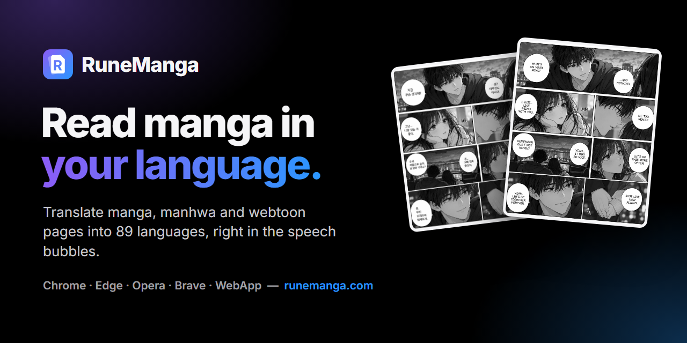
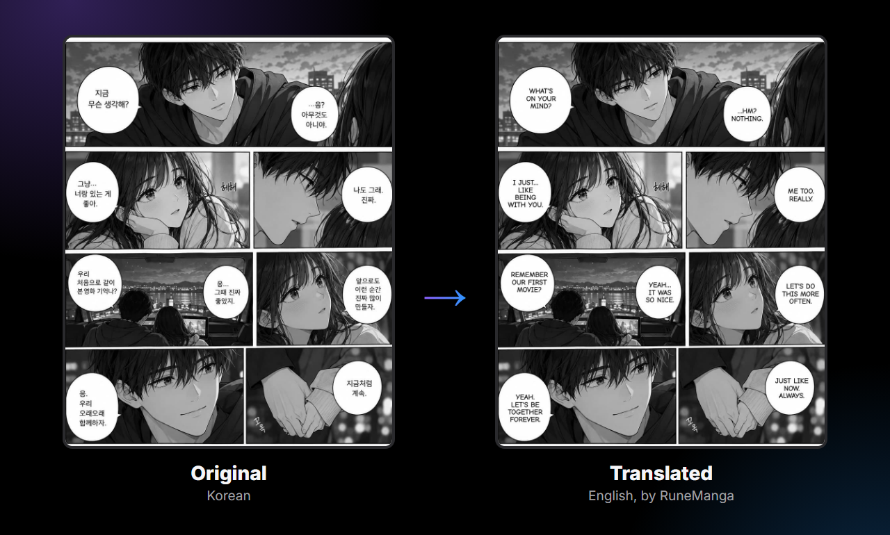
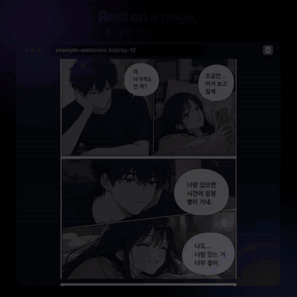
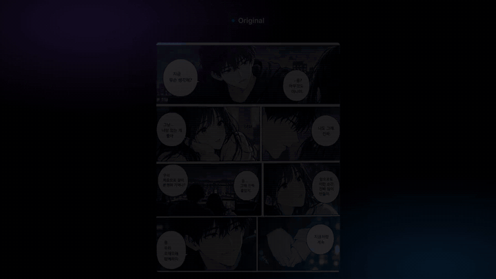

# RuneManga

### Translate manga, manhwa and webtoons into your language, right inside the speech bubbles

**RuneManga finds the dialogue on a comic page, erases the original lettering, fills in the art underneath and sets the translation back into each bubble, so you get a page you can read instead of a screenshot with subtitles on top.**
A browser extension for the reader sites you already use, and a WebApp for the pages on your computer. Japanese, Korean, Chinese, English and six more source languages, detected automatically. 89 target languages. Free to start, 30 credits at sign-up, no card.

**[Website](https://runemanga.com/?utm_source=github&utm_medium=readme&utm_campaign=runemanga-public)** · **[Guides](https://runemanga.com/guides)** · **[Use cases](https://runemanga.com/use-cases)** · **[FAQ](https://runemanga.com/faq)** · **[Compare](https://runemanga.com/compare)** · **[Glossary](https://runemanga.com/glossary)** · **[Changelog](https://runemanga.com/changelog)**

**In this repo:** [Features & plans](docs/features.md) · [Languages](docs/languages.md) · [Sites & browsers](docs/sites-and-browsers.md) · [Comparison](docs/comparison.md) · [FAQ](docs/faq.md) · [Troubleshooting](docs/troubleshooting.md)

  

---

## Contents

- [What RuneManga does](#what-runemanga-does)
- [Get started in a minute](#get-started-in-a-minute)
- [How to translate a manga page in three steps](#how-to-translate-a-manga-page-in-three-steps)
- [The browser extension: translate while you read](#the-browser-extension-translate-while-you-read)
- [The WebApp: translate pages from your computer](#the-webapp-translate-pages-from-your-computer)
- [RuneLingua, the translator on every plan](#runelingua-the-translator-on-every-plan)
- [Languages: 11 to read, 89 to translate into](#languages-11-to-read-89-to-translate-into)
- [What it translates today, and what it leaves alone](#what-it-translates-today-and-what-it-leaves-alone)
- [Pricing](#pricing)
- [Privacy: what happens to your pages](#privacy-what-happens-to-your-pages)
- [RuneManga vs Torii, Ichigo Reader, manga-image-translator, Google Lens and BallonsTranslator](#runemanga-vs-torii-ichigo-reader-manga-image-translator-google-lens-and-ballonstranslator)
- [Frequently asked questions](#frequently-asked-questions)
- [Troubleshooting: when a page comes out wrong](#troubleshooting-when-a-page-comes-out-wrong)
- [Links and community](#links-and-community)

---

## What RuneManga does

There are two easy ways to read a comic in a language you do not know: point a general image translator at it and read the subtitles it draws on top, or wait for someone to translate it by hand. RuneManga is a third way. It treats the page as a page.

For every page you give it, RuneManga runs the same pipeline:

1. **Find the text.** The speech bubbles on the page are located.
2. **Read it.** Text recognition turns the lettering into characters. Japanese uses a reader built for manga; Korean and Chinese are supported and still improving.
3. **Translate it.** RuneLingua, RuneManga's own AI translator for manga and manhwa dialogue, writes the translation, on every plan.
4. **Erase the original.** The old lettering is removed and the background underneath is filled in, instead of being hidden behind a white box.
5. **Typeset it.** The translation is set back into the same bubble, at the largest size that fits.

  

- **Two ways to use it:** a [browser extension](#the-browser-extension-translate-while-you-read) that translates pages in place on the sites you read, and a [WebApp](#the-webapp-translate-pages-from-your-computer) that takes images, a folder or a ZIP and gives you the translated pages back
- **Manga, manhwa, manhua and webtoons:** black-and-white Japanese pages and full-colour vertical strips alike. On a coloured page only the lettering changes; the colours stay exactly as they are
- **89 target languages**, from English, Spanish and Turkish to Indonesian, Polish and Ukrainian. Arabic and Thai output is experimental
- **One credit per page.** Pages that fail, or that are already in your language, cost nothing
- **Pages are deleted** about an hour after the job finishes and are never used to train models

> **RuneManga is in beta.** Machine translation can contain mistakes, so treat a translated page as a reading aid, not an official release. Use RuneManga only on pages you have the right to process, such as your own work, licensed work or material you may read for personal use.

📖 **[What is RuneManga? A manga and manhwa translator](https://runemanga.com/guides/what-is-runemanga)** · **[How does AI manga translation work?](https://runemanga.com/guides/how-ai-manga-translation-works)**

---

## Get started in a minute

| You want to... | Use | How |
|---|---|---|
| Read a series on a reader site in your language | **Browser extension** | [Add to Chrome](https://chromewebstore.google.com/detail/runemanga/cmclohfalopabbnmeoocelikbibbpppn) (also Opera, Brave, Vivaldi, Arc and other Chromium browsers) or [get it for Edge](https://microsoftedge.microsoft.com/addons/detail/gmhdmcggedcjfmijpkladmmimfahnhjm). A Firefox version is in review |
| Translate pages you already have as files, a folder or a ZIP | **WebApp** | Open [runemanga.com](https://runemanga.com/?utm_source=github&utm_medium=readme&utm_campaign=runemanga-public) on any device, sign in and drop the pages in |
| Try it before installing anything | **WebApp** | The same, with nothing to install, on a phone, tablet or computer |

Both need a free account. Sign in with **Google, Discord or a link we email you**: no password, no card, and every new account gets **30 free credits** at once.

---

## How to translate a manga page in three steps

**1. Add the pages.** In the WebApp, choose files or a folder, drop them onto the box, add a ZIP, or paste an image with Ctrl+V. In the extension, open a chapter on the site you read and rest the pointer on a page: the RuneManga button appears in its corner.

**2. Pick the language you read.** Choose it under *Translate into*. There is nothing to set for the original: the language on the page is detected automatically.

**3. Translate, check, keep.** Press the button. In the WebApp you follow the progress page by page, flip between *Original* and *Result*, and download one page as a PNG or the whole chapter as a ZIP. In the extension the translated page is swapped in place; click again, or press and hold, to see the original.

📖 Step-by-step walkthroughs: **[Translate manga online, step by step](https://runemanga.com/guides/translate-manga-online-step-by-step)** · **[Translate your first chapter](https://runemanga.com/guides/translate-your-first-chapter)** · **[Japanese manga to English](https://runemanga.com/guides/translate-japanese-manga-to-english)** · **[Korean manhwa to English](https://runemanga.com/guides/translate-korean-manhwa-to-english)** · **[Chinese manhua to English](https://runemanga.com/guides/translate-chinese-manhua-to-english)** · **[Manhwa and webtoons](https://runemanga.com/guides/translate-manhwa-and-webtoons)**

---

## The browser extension: translate while you read

The extension translates manga and manhwa where you already read them. You never download or upload a file: the page in front of you is translated and put back in place.

- **One button per page.** Rest the pointer on a page and click the RuneManga button in its corner to translate just that page.
- **Auto mode.** Turn on *Auto* in a page's bar or in the popup and pages translate as they scroll into view. It works from about half a screen behind you to about two screens ahead, nearest first, so the pages you are about to read are ready and a whole chapter is never pushed through at once. Auto is remembered per site.
- **Show the original.** Switch any translated page back, or press and hold it to peek at the original while you hold.
- **Translate an area.** Drag a box over any part of the page and only that part is translated. It is the answer for readers that draw their pages in a protected canvas no extension can read.
- **Right-click menu.** *Translate image*, *Translate an area*, *Repeat last area*, *Screenshot an area*, *Download translated image* and an Auto toggle.
- **Keyboard shortcuts** to switch a site on or off, translate an area, and flip between originals and translations.
- **Pause and resume**, and automatic retries when the service is busy.
- **History in your browser.** Your last translated pages stay in the extension, with their originals, to view or download again. An image you already translated shows its translation again at once, without a new credit. Optional Auto-save writes each page into a folder under Downloads.
- **Your own AI key, with the next extension update.** RuneLingua is the default on every plan. The next extension update lets you switch to Google Translate in your browser, or connect your own key for OpenRouter, Google, OpenAI, Anthropic, DeepSeek, xAI or any OpenAI-compatible service. The key stays in your browser and goes only to that provider; pages still use your RuneManga credits.
- **Report a problem** from the popup, with a screenshot of the tab attached if you like.

Works in **Chrome, Edge, Opera, Brave, Vivaldi, Arc** and other Chromium-based browsers. A **Firefox** version is in review. There is no Safari version.

 

📖 **[Manga translator browser extension: how it works](https://runemanga.com/guides/manga-translator-browser-extension)** · **[Translate manga while you read](https://runemanga.com/guides/translate-manga-while-you-read)** · **[Best manga translator extensions compared](https://runemanga.com/guides/best-manga-translator-extension)**

➡️ **Which readers work, and what to do on the ones that hide their images: [docs/sites-and-browsers.md](docs/sites-and-browsers.md)**

---

## The WebApp: translate pages from your computer

No install: open [runemanga.com](https://runemanga.com/?utm_source=github&utm_medium=readme&utm_campaign=runemanga-public), sign in, and add a chapter.

| | |
|---|---|
| **Ways to add pages** | Choose files, choose a folder (subfolders are read too), drag and drop, a ZIP, or paste an image with Ctrl+V |
| **Image formats** | PNG, JPG, WebP, GIF and AVIF. A CBZ works after renaming it to `.zip` |
| **Not accepted** | PDF, TIFF, BMP and HEIC: export them as PNG or JPG first |
| **Size** | Up to 20 MB per page |
| **Pages per job** | 50 on Free, 100 on Supporter, 200 on Pro, 500 on Ultimate |
| **Order** | Sorted by file name with numbers in natural order, so `2.png` comes before `10.png` |
| **What you get back** | Each page as a PNG, or the whole chapter in one ZIP, numbered in order |

A ZIP is opened in your browser, so nothing is uploaded until you press the translate button. Hidden files and `__MACOSX` folders are skipped. Results are deleted about an hour after the job, so download what you want to keep.

📖 **[Upload a ZIP, a folder or a pasted image](https://runemanga.com/guides/upload-zip-folder-paste)** · **[How to translate a manga PDF](https://runemanga.com/guides/translate-manga-pdf)** · **[Best image quality for manga translation](https://runemanga.com/guides/best-image-quality-for-manga-translation)**

---

## RuneLingua, the translator on every plan

**RuneLingua is RuneManga's own AI translator, built for the dialogue in manga and manhwa, and it runs on our servers.** It translates the pages of every plan, Free included. There is nothing to switch on and nothing extra to pay.

Comic dialogue is a different kind of text from documents and websites: short lines and exclamations, slang and banter, honorifics with no direct equivalent, subjects left out so the reader has to know who is speaking, and names that must stay the same across pages. RuneLingua is tuned for that kind of text.

**Google Translate still has a role.** A few target languages RuneLingua does not write well yet, such as Swahili, Zulu and Quechua, are translated with Google Translate, and so is a page when RuneLingua is briefly unavailable, so a chapter does not stop halfway. RuneLingua is new and still improving; we do not claim it beats Google Translate, so judge it on your own series.

Either way, **the translator only receives the text found on the page, never the image.**

📖 **[What is RuneLingua? Our AI manga translator](https://runemanga.com/guides/what-is-runelingua)**

---

## Languages: 11 to read, 89 to translate into

| | |
|---|---|
| **Read (source)** | Japanese · Korean · Chinese (Simplified) · Chinese (Traditional) · English · Spanish · French · Portuguese · Indonesian · Vietnamese · Thai, detected automatically |
| **Translate into, first listed** | English · Turkish · Spanish · Portuguese · French · German · Russian · Indonesian · Vietnamese · Arabic *(experimental)* · Thai *(experimental)* |
| **Translate into, also** | 78 more, from Afrikaans, Czech, Dutch, Filipino, Greek, Italian, Malay, Polish, Romanian and Swedish to Ukrainian, Welsh and Zulu |

It is not only Japanese and Korean into English: an English comic into Spanish, or a Spanish one into Turkish, works the same way. Japanese is the source RuneManga reads best today; Korean and Chinese recognition is still improving.

**Arabic and Thai** output is experimental: their lettering is not verified yet. The **website and the extension themselves** are available in 13 languages: English, Español, Português, Français, Русский, 中文, Türkçe, Deutsch, Bahasa Indonesia, 한국어, العربية, 日本語 and ไทย.

➡️ **All 89 target languages by name: [docs/languages.md](docs/languages.md)**

---

## What it translates today, and what it leaves alone

| Text on the page | Today |
|---|---|
| Dialogue in speech bubbles | ✅ Translated, the lettering erased and the translation set in the same bubble |
| Vertical Japanese lettering | ✅ Read bubble by bubble and set horizontally; one of the harder cases, best on large, clean scans |
| Coloured manhwa and webtoon pages | ✅ Translated with the colours untouched |
| Narration boxes, captions and loose text on the art | ⏳ Not translated yet. Translating text outside bubbles is the next big piece being worked on |
| Sound effects drawn into the art | Left as drawn, on purpose. An option for them may come later |
| Colourising black-and-white pages | ⏳ Colorizer: coming soon. We're working on it now; it is not part of any plan yet |

Translated text can look smaller than the original: a translation is often longer, the bubble cannot grow, and the text is shrunk until it fits rather than running over the art.

📖 **[Why RuneManga misses some text on a page](https://runemanga.com/guides/translator-misses-some-text)** · **[Why manga sound effects are not translated](https://runemanga.com/guides/why-sound-effects-are-not-translated)** · **[Why translated text does not fit the bubble](https://runemanga.com/guides/translated-text-does-not-fit-the-bubble)**

---

## Pricing

**One credit translates one page, on every plan, with the same translator.** Plans differ by how many credits you get, how many pages fit in one job and how many pages are translated at the same time.

| | **Free** | **Supporter** | **Pro** | **Ultimate** |
|---|---|---|---|---|
| Price | $0 | $2.99 / month | $4.99 / month | $9.99 / month |
| Credits | 30 once, at sign-up | 750 / month | 2,000 / month | 5,000 / month |
| RuneLingua AI translator | ✅ | ✅ | ✅ | ✅ |
| WebApp and browser extension | ✅ | ✅ | ✅ | ✅ |
| All supported languages | ✅ | ✅ | ✅ | ✅ |
| Pages per job (WebApp) | 50 | 100 | 200 | 500 |
| Pages translated at the same time | 1 | 2 | 3 | 4 |

**Credit packs**, open to everyone including Free, are one-time purchases that never expire: **1,000 credits for $4.99, 2,500 for $7.99, 6,000 for $14.99.**

- Pages that fail, or that are already in your language, cost nothing
- Free and pack credits never expire. Plan credits renew on your renewal date and unused ones do not carry over
- Your plan's credits are always used before pack credits
- Payments are handled by Lemon Squeezy. Change or cancel at any time from your account page; a cancelled plan runs until the end of the period you paid for. See the [refund policy](https://runemanga.com/refunds)

Prices are in USD. **The current prices are always at [runemanga.com/#pricing](https://runemanga.com/?utm_source=github&utm_medium=readme&utm_campaign=runemanga-public#pricing).**

➡️ **Every feature, and which plan gives what: [docs/features.md](docs/features.md)** · 📖 **[RuneManga free plan explained](https://runemanga.com/guides/runemanga-free-plan-explained)**

---

## Privacy: what happens to your pages

- Pages are processed on **our servers**. Only the **text** found on a page goes to the translator, never the image.
- Uploads and results are **deleted automatically about an hour after the job finishes**. Pages are **not used to train models**, not sold and not shown to other users.
- The extension sends the page images you translate under a neutral file name, and **never the page address, your browsing history or your cookies**. Its History stays in your browser and is never uploaded.
- The website's only analytics is Google Analytics counting visits, which you can turn off. In the EU and EEA, the UK, Switzerland and Türkiye it runs only after you accept it.
- There is no password. Card details stay with Lemon Squeezy. You can delete your account at any time on the Account page.

The [Privacy Policy](https://runemanga.com/privacy) is the full text and wins if anything here ever differs.

📖 **[Is RuneManga safe? What happens to your pages](https://runemanga.com/guides/what-happens-to-your-pages)** · **[Is a manga translator safe? What to check](https://runemanga.com/guides/is-a-manga-translator-safe)**

---

## RuneManga vs Torii, Ichigo Reader, manga-image-translator, Google Lens and BallonsTranslator

| | What it is | What you get |
|---|---|---|
| **RuneManga** | Hosted translator: browser extension and WebApp | Re-lettered pages in place or as PNG / ZIP, with a $0 Free plan |
| **Torii Image Translator** | Hosted translator: extension, WebApp, editor, colorizer | Re-lettered pages you can edit, paid with credit packs |
| **Ichigo Reader** | Reader-first subscription: upload page, Chrome extension, apps | Translated text shown over the page, with a free trial |
| **manga-image-translator** | Open-source pipeline you run yourself | Full control and offline options, if you install it |
| **Google Lens** | General-purpose image translator | A quick idea of what one image says |
| **BallonsTranslator** | Open-source desktop editor | A workbench to correct every bubble by hand |

Competitor facts come from each tool's own pages and store listings, as checked on 2026-10-21.

➡️ **The full comparison, tool by tool: [docs/comparison.md](docs/comparison.md)**

Head to head on the site: **[vs Torii](https://runemanga.com/compare/runemanga-vs-torii)** · **[vs Ichigo Reader](https://runemanga.com/compare/runemanga-vs-ichigo-reader)** · **[vs manga-image-translator](https://runemanga.com/compare/runemanga-vs-manga-image-translator)** · **[vs Google Lens](https://runemanga.com/compare/runemanga-vs-google-lens)** · **[vs BallonsTranslator](https://runemanga.com/compare/runemanga-vs-ballonstranslator)**

---

## Frequently asked questions

### Is RuneManga free?

Yes. Every new account gets 30 free credits once, and they never expire, translated with RuneLingua like every other plan. When you need more, Supporter, Pro and Ultimate add credits every month and credit packs never expire.

### Do I need an account?

Yes, a free one, for the WebApp and the extension: sign in with Google, Discord or an emailed link. No password and no card.

### Which browsers does the extension work in?

Chrome, Edge, Opera, Brave, Vivaldi, Arc and other Chromium-based browsers. A Firefox version is in review. There is no Safari version.

### Can I choose the language of the original page?

There is no need: the original language is detected automatically, among Japanese, Korean, Simplified and Traditional Chinese, English, Spanish, French, Portuguese, Indonesian, Vietnamese and Thai.

### Can it colourise manga?

Not yet. Colorizer: coming soon, we're working on it now. Until then, Translate works on black-and-white and coloured pages today.

### Does a paid plan translate better?

No. Every plan uses the same pipeline and the same translator. A paid plan gives you more credits, bigger jobs and more pages translated at the same time.

### Is RuneManga a manga library?

No. RuneManga translates the pages you open or upload. It does not host or publish comics.

➡️ **The long-form FAQ: [docs/faq.md](docs/faq.md)** · **[More answers at runemanga.com/faq](https://runemanga.com/faq)**

---

## Troubleshooting: when a page comes out wrong

1. **Start from a better image.** Most bad results are reading problems, not translation problems: use the largest, least compressed copy of the page, uncropped and not stitched to its neighbours.
2. **Check what was missed.** Text outside bubbles is not translated yet and sound effects stay as drawn. A missed line *inside* a clean bubble is worth reporting.
3. **Run the page again.** In the extension, click the page's button again. In the WebApp, start over with only that page.
4. **Ask for help.** Use *Report a problem* in the extension, the Support page on the website when signed in, [Discord](https://discord.gg/TRwM9zgJPG) or [support@runemanga.com](mailto:support@runemanga.com).

The usual suspects, each with a fix: [some text is still in the original language](docs/troubleshooting.md#some-text-is-still-in-the-original-language) · [the translation is tiny](docs/troubleshooting.md#the-translated-text-is-tiny-or-crowded) · [the extension does nothing on a site](docs/troubleshooting.md#the-extension-does-nothing-on-a-site) · [a page says it cannot be read](docs/troubleshooting.md#a-page-says-it-cannot-be-read) · [an upload is refused](docs/troubleshooting.md#an-upload-is-refused)

➡️ **All of them: [docs/troubleshooting.md](docs/troubleshooting.md)**

---

## Links and community

| | |
|---|---|
| 🌐 **Website** | [runemanga.com](https://runemanga.com/?utm_source=github&utm_medium=readme&utm_campaign=runemanga-public) |
| 🧩 **Chrome Web Store** | [RuneManga for Chrome](https://chromewebstore.google.com/detail/runemanga/cmclohfalopabbnmeoocelikbibbpppn) (Opera, Brave, Vivaldi and Arc install from here too) |
| 🧩 **Edge Add-ons** | [RuneManga for Edge](https://microsoftedge.microsoft.com/addons/detail/gmhdmcggedcjfmijpkladmmimfahnhjm) |
| 📖 **Guides** | [runemanga.com/guides](https://runemanga.com/guides) |
| 📚 **Use cases** | [Manga](https://runemanga.com/use-cases/manga) · [Manhwa and webtoons](https://runemanga.com/use-cases/manhwa-webtoons) · [Manhua](https://runemanga.com/use-cases/manhua) |
| 🔤 **Glossary** | [runemanga.com/glossary](https://runemanga.com/glossary) |
| ❓ **FAQ** | [runemanga.com/faq](https://runemanga.com/faq) |
| ⚖️ **Compare** | [runemanga.com/compare](https://runemanga.com/compare) |
| 📝 **Changelog** | [runemanga.com/changelog](https://runemanga.com/changelog) |
| 👋 **About** | [runemanga.com/about](https://runemanga.com/about) |
| 💬 **Discord** | [discord.gg/TRwM9zgJPG](https://discord.gg/TRwM9zgJPG) |
| ▶️ **YouTube** | [@rrunemanga](https://www.youtube.com/@rrunemanga) |
| ✉️ **Email** | [support@runemanga.com](mailto:support@runemanga.com) |

### In this repository

This repository, RuneMangaPublic, is RuneManga's public information hub. RuneManga is closed-source: there is no app code here and nothing is distributed from it. Get the extension from the Chrome Web Store or Edge Add-ons, and use the WebApp at runemanga.com.

- **[docs/features.md](docs/features.md)**: the complete feature list, extension vs WebApp, and which plan gives what
- **[docs/languages.md](docs/languages.md)**: the 11 source languages, all 89 target languages by name, and the site languages
- **[docs/sites-and-browsers.md](docs/sites-and-browsers.md)**: supported browsers, how the extension works on reader sites, and the files the WebApp takes
- **[docs/comparison.md](docs/comparison.md)**: RuneManga next to the other manga translators
- **[docs/faq.md](docs/faq.md)**: the long-form FAQ
- **[docs/troubleshooting.md](docs/troubleshooting.md)**: when a page comes out wrong
- **[SUPPORT.md](SUPPORT.md)**: how to get help · **[SECURITY.md](SECURITY.md)**: reporting a vulnerability

RuneManga is built by two people, Engin and Mert, and is a RuneTranslate product operated from Türkiye. More at [runemanga.com/about](https://runemanga.com/about). The sample pages in this README were made for RuneManga.

---

### [📖 Read your next chapter in your language at runemanga.com](https://runemanga.com/?utm_source=github&utm_medium=readme&utm_campaign=runemanga-public)

<b>Guides:</b>
<a href="https://runemanga.com/guides/translate-japanese-manga-to-english">Japanese manga to English</a> ·
<a href="https://runemanga.com/guides/translate-korean-manhwa-to-english">Korean manhwa to English</a> ·
<a href="https://runemanga.com/guides/translate-chinese-manhua-to-english">Chinese manhua to English</a> ·
<a href="https://runemanga.com/guides/translate-manhwa-and-webtoons">Manhwa and webtoons</a> ·
<a href="https://runemanga.com/guides/translate-manga-pdf">Manga PDF</a> ·
<a href="https://runemanga.com/guides/best-free-manga-translator">Best free manga translator</a> ·
<a href="https://runemanga.com/guides/google-lens-manga-translation-not-working">Google Lens not working?</a> ·
<a href="https://runemanga.com/guides/manga-vs-manhwa-vs-manhua">Manga vs manhwa vs manhua</a> ·
<a href="https://runemanga.com/glossary/ocr">OCR</a> ·
<a href="https://runemanga.com/glossary/inpainting">Inpainting</a> ·
<a href="https://runemanga.com/glossary/typesetting">Typesetting</a>

RuneManga is an independent service and is not affiliated with, endorsed by, or connected to any publisher, reader site, browser vendor or translation provider named here. Product and company names are the trademarks of their respective owners. © 2026 RuneManga.

